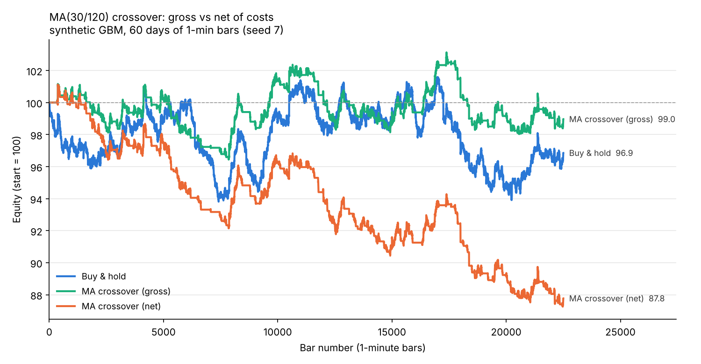

# event-driven-backtester

**Question:** Can I build a backtester whose numbers I can trust (no lookahead, realistic costs), and prove it by matching an independent vectorised calculation?

A small, single-instrument, event-driven backtester in plain Python (numpy/pandas). It's a correctness exercise, not a framework.

## Method

```
bar t closes ─► MarketEvent ─► Strategy (sees bars 0..t only) ─► SignalEvent(target weight)
            ─► Portfolio ─► OrderEvent ─► ExecutionHandler ── fills at bar t+1 OPEN ──► FillEvent ─► Portfolio
```

| Component | Design decision | Why |
|---|---|---|
| `DataHandler` / `BarView` | Strategies get a read-only view. `bar(+1)` raises `LookaheadError` | Makes lookahead a crash, not a silent bias |
| `ExecutionHandler` | Orders decided on bar *t*'s close fill at bar *t+1*'s **open** | You can't trade at the close you just used to decide |
| `CostModel` | Slippage + half-spread move the **fill price**; commission/taxes are charged in **cash** | Keeps impact and explicit fees separately measurable |
| `IndianEquityCostModel` | NSE intraday schedule: brokerage min(0.03%, ₹20), STT 0.025% sell, txn 0.00307%, SEBI ₹10/cr, GST 18%, stamp 0.003% buy ([source](https://zerodha.com/charges), checked 2026-10-03) | Realistic retail costs, not a flat guess |
| `Portfolio` | Long-only, fractional units, target-weight sizing | Simple enough to verify by hand |

Metrics: total return, CAGR, annualised Sharpe (bars/year inferred from the data), max drawdown, trade count, turnover, fees paid, slippage+spread paid, cost drag.

## How I know it's right (tests)

`make test` runs 10 tests:

| Test | What it proves |
|---|---|
| Buy-and-hold, zero cost == `close[-1] / open[1] - 1` (tol 1e-9) | Accounting is exact |
| Strategy calling `view.bar(+1)` raises `LookaheadError` | Future data is unreachable |
| History seen at bar *t* ends exactly at *t* | No leakage via `history()` |
| First fill is at bar 1's open, not bar 0 | Next-bar execution |
| **MA crossover equity == vectorised pandas version (rtol 1e-9)** over ~3,700 bars with >5 trades | Event loop and an independent vectorised calc agree to floating-point precision |
| 5-bar hand calculation with 10 bps commission + 10 bps slippage | Costs hit exactly where they should |
| Round trip with 50 bps half-spread on buy and sell | Sell-side costs and flat position |
| Indian fee schedule on ₹1,00,000 and ₹10,000 orders | Brokerage cap and GST base are correct |
| Sample/synthetic share schema; synthetic is seeded | Data contract holds |

## Result



| Run | Total return | Sharpe | Max DD | Trades | Fees paid | Slippage+spread paid |
|---|---|---|---|---|---|---|
| Buy & hold | -3.14% | -0.68 | -7.56% | 1 | 91 | 300 |
| MA(30/120) gross | -1.03% | -0.30 | -4.95% | 239 | 0 | 0 |
| MA(30/120) net | **-12.23%** | -4.38 | -13.71% | 239 | 45,283 | 67,214 |

*Synthetic GBM, 60 days of 1-min bars, seed 7, start capital 1,000,000; costs = Indian schedule + 2 bps slippage + 1 bp half-spread.*

**Takeaway:** on a random walk the crossover has no edge (gross ≈ flat, as it should be), and 239 fills (~120 round trips) at ~5 bps of traded notional each burn **~11% of capital in costs**. An intraday signal on this cost base needs a large per-trade edge just to break even. The demo is meant to show this cost drag. It is not a strategy.

## Limitations (honest)

- Bar-level fills at the open; there are no partial fills, no queue position, and no intrabar stops.
- Fixed bps slippage, no market impact that grows with size.
- Single instrument, long-only, fractional units, no margin or leverage. A fully invested account carries a small negative cash balance equal to fees.
- Sharpe on 1-min bars assumes i.i.d. returns. Annualisation is approximate.
- Synthetic data is plain GBM: no fat tails, jumps, intraday seasonality, or holidays.
- The fee schedule is a snapshot. Rates change, so check them before use.

## How to run

```bash
make setup   # pip install -r requirements.txt
make test    # 10 tests, ~2 s
make demo    # writes outputs/equity_curves.png + outputs/metrics.md, ~15 s
```

**Plug in real data** (no code changes). Drop a CSV in `data/raw/` (gitignored) and run:

```bash
PYTHONPATH=src:. python3 -m edbt.demo --csv data/raw/nifty_1min.csv --ts-col date
```

`data/loaders.py::load_real` maps any OHLC(V) file to the same schema as `load_synthetic`. Use `rename=` for non-standard column names. A missing `volume` (index data) is filled with 0.

## Repo layout

```
src/edbt/   events, data_handler, strategy, portfolio, execution, costs, engine, metrics, demo
data/       loaders.py, synthetic.py, sample/ (2-day synthetic sample, committed)
tests/      test_backtester.py
outputs/    equity_curves.png, metrics.md
```

## Possible extensions (not built, on purpose)

Multiple instruments, short selling, limit and stop orders, volume-based slippage, walk-forward parameter selection.
